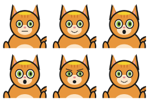
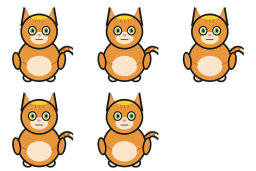
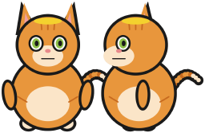
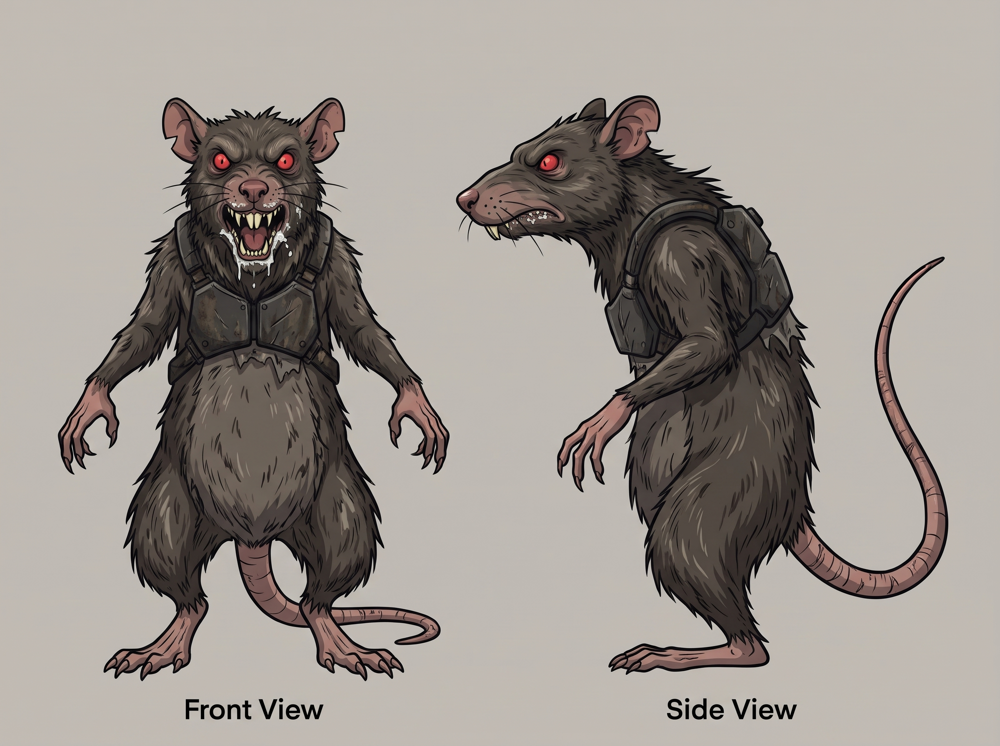
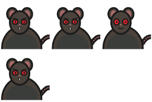
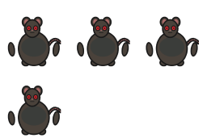
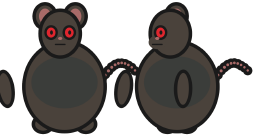
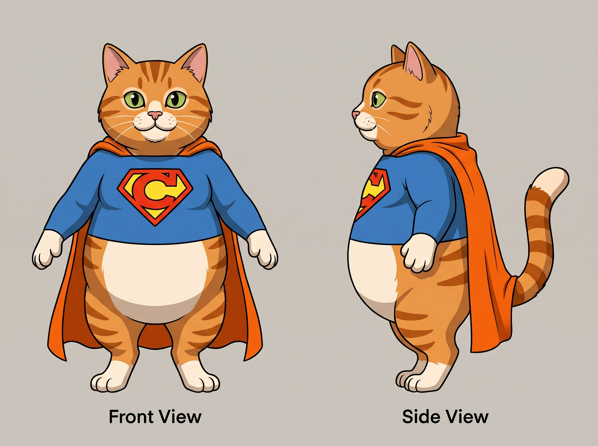
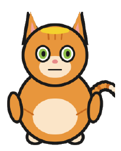
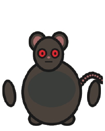

# character-library 0.1.0

Reusable character art for the Colby/Pete universe: turnaround sheets, bibles, prompts, billboards in several styles

License: CC0-1.0 | Assets: 10 (character 8, sprite 2) | Library hash: `4a5ea3398ef5`

Generated by `library.index`; do not edit. Machine-readable: [INDEX.json](INDEX.json).

## character

| Preview | Id | Name | Size | Tags | License | Version |
|---|---|---|---|---|---|---|
|  | [`colby.toon.expressions`](assets/colby.toon.expressions/asset.json) | Colby: toon expressions | 768x512 | character:colby, generator:mock, quality:placeholder, role:hero, species:cat, style:cartoon-vector | CC0-1.0 | 1.0.0 |
|  | [`colby.toon.pose-sheet`](assets/colby.toon.pose-sheet/asset.json) | Colby: toon pose sheet | 768x512 | character:colby, generator:mock, quality:placeholder, role:hero, species:cat, style:cartoon-vector | CC0-1.0 | 1.0.0 |
|  | [`colby.toon.turnaround`](assets/colby.toon.turnaround/asset.json) | Colby: toon turnaround | 1133x738 | character:colby, generator:mock, quality:placeholder, role:hero, species:cat, style:cartoon-vector | CC0-1.0 | 1.0.0 |
|  | [`perring-parkway-pete.toon-turnaround`](assets/perring-parkway-pete.toon-turnaround/asset.json) | Perring Parkway Pete: toon front/side turnaround | 2400x1792 | character:pete, role:villain, species:rat, style:cartoon-vector, view:turnaround | CC0-1.0 | 0.1.0 |
|  | [`perring-parkway-pete.toon.expressions`](assets/perring-parkway-pete.toon.expressions/asset.json) | Perring Parkway Pete: toon expressions | 768x512 | character:perring-parkway-pete, generator:mock, quality:placeholder, role:villain, species:rat, style:cartoon-vector | CC0-1.0 | 1.0.0 |
|  | [`perring-parkway-pete.toon.pose-sheet`](assets/perring-parkway-pete.toon.pose-sheet/asset.json) | Perring Parkway Pete: toon pose sheet | 768x512 | character:perring-parkway-pete, generator:mock, quality:placeholder, role:villain, species:rat, style:cartoon-vector | CC0-1.0 | 1.0.0 |
|  | [`perring-parkway-pete.toon.turnaround`](assets/perring-parkway-pete.toon.turnaround/asset.json) | Perring Parkway Pete: toon turnaround | 1145x608 | character:perring-parkway-pete, generator:mock, quality:placeholder, role:villain, species:rat, style:cartoon-vector | CC0-1.0 | 1.0.0 |
|  | [`super-colby.toon-turnaround`](assets/super-colby.toon-turnaround/asset.json) | Super Colby: toon front/side turnaround | 2400x1792 | character:colby, character:super-colby, role:hero, species:cat, style:cartoon-vector, view:turnaround | CC0-1.0 | 0.1.0 |

## sprite

| Preview | Id | Name | Size | Tags | License | Version |
|---|---|---|---|---|---|---|
|  | [`colby.toon.billboard`](assets/colby.toon.billboard/asset.json) | Colby: toon billboard | 256x320 | character:colby, generator:mock, quality:placeholder, role:hero, species:cat, style:cartoon-vector | CC0-1.0 | 1.0.0 |
|  | [`perring-parkway-pete.toon.billboard`](assets/perring-parkway-pete.toon.billboard/asset.json) | Perring Parkway Pete: toon billboard | 256x320 | character:perring-parkway-pete, generator:mock, quality:placeholder, role:villain, species:rat, style:cartoon-vector | CC0-1.0 | 1.0.0 |

